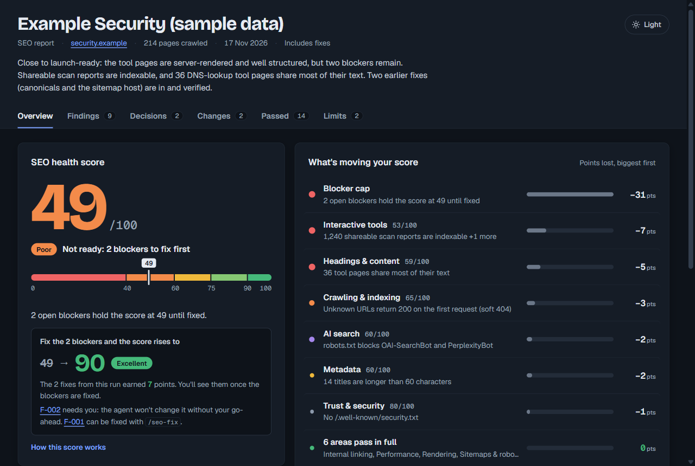

<h1 align="center">SEO Supervisor</h1>

<p align="center">
  <b>Audits, fixes and guards your site's SEO from inside your coding agent, and never touches your content without asking.</b>
</p>

<p align="center">
  <a href="https://github.com/m-zaman-khan/seo-supervisor/actions/workflows/ci.yml"></a>
  <a href="https://www.npmjs.com/package/seo-supervisor"></a>
  <a href="LICENSE"></a>
  
  
</p>

<p align="center">
  <a href="https://m-zaman-khan.github.io/seo-supervisor/"><b>See a live sample report →</b></a>
</p>

<p align="center">
  
</p>

SEO Supervisor is a skill for Claude Code and other coding agents. It crawls your site the way Google does and checks it against 149 current SEO rules. Then it gives you one clear report: a 0–100 score, every problem with its evidence, and what to do first.

Then it fixes what can safely be fixed in code, re-checks each fix, and tells you plainly what only you can fix.

```bash
npx seo-supervisor        # then, in Claude Code: /seo-audit
```

## Contents

- [Install](#install)
- [Commands](#commands)
- [Starting from zero](#starting-from-zero)
- [The report](#the-report)
- [What it checks](#what-it-checks)
- [Safe by default](#safe-by-default)
- [Tested](#tested)
- [FAQ](#faq)

## Install

Pick **one** of these per machine.

**Claude Code plugin**

```text
/plugin marketplace add m-zaman-khan/seo-supervisor
/plugin install seo-supervisor@seo-supervisor
```

Claude Code puts the plugin name in front of plugin commands, so they appear as `/seo-supervisor:seo-audit` and so on.

**One command with npx** (any agent)

```bash
npx seo-supervisor
```

It asks two things:

1. **Install for:** you, in every project, or this project only (to commit for your team).
2. **Which agents:** a checklist of 20 coding agents, including Claude Code, Codex, Cursor, Windsurf, Gemini CLI, GitHub Copilot, OpenCode, Grok, Cline and Kiro. The agents installed on your machine are found and ticked for you.

```text
? Which agents? (space to select, a for all, enter to confirm)
❯ ◉ Claude Code          found · ~/.claude/skills
  ◉ Codex                found · ~/.agents/skills
  ◉ Cursor               found · ~/.cursor/skills
  ◯ Windsurf             ~/.codeium/windsurf/skills
  …
```

The skill goes into each agent's own skills folder, and agents that share a folder get one copy. Claude Code also gets the `/seo-audit`, `/seo-fix`, `/seo-review`, `/seo-launch` and `/seo-setup` commands. In other agents, ask them to "audit the SEO of this site". The installer only ever replaces or removes its own files.

For scripts and CI, use flags to skip the questions:

```bash
npx seo-supervisor --agent claude-code,cursor --scope project   # those agents, in this project
npx seo-supervisor --yes                                        # the agents it finds, for you
npx seo-supervisor --uninstall                                  # remove it again
```

`npx seo-supervisor --help` lists every agent key. Using an agent that isn't on the list? `npx skills add m-zaman-khan/seo-supervisor` covers 40+ more.

Needs Node 20 or newer. There's nothing else to install, and no API keys.

## Commands

| Command | What it does | Edits anything? |
| --- | --- | --- |
| `/seo-audit [url]` | Crawls a production build of your site, inspects the code and the content data, and writes the report to `seo-audit/` | Never |
| `/seo-fix [F-001 F-004]` | Fixes the named findings, or all open ones, at the root (the shared metadata helper, sitemap or layout), re-checks each fix and updates the report | Only what you approved |
| `/seo-review [PR or branch]` | Finds the SEO problems a change introduces: a lost canonical, an accidental noindex, a dropped H1, made-up ratings… | Never |
| `/seo-launch [url]` | A pass/fail gate before you switch indexing on, plus the launch-day checklist | Never |
| `/seo-setup [url]` | For a site with **no SEO yet**: proposes a full SEO plan, then builds it once you approve | Only after you approve the plan |

## Starting from zero

New site, or an old app that never had any SEO? Run `/seo-setup`. It plans first instead of handing you 60 problems:

1. **It works out what your site is** from your own pages and routes. A landing page, a SaaS app, a blog, a shop, a portfolio and a local business each get a different plan, and none of them get pages they don't need.
2. **It proposes the plan on a Plan tab.** That covers every page's title, description, H1, schema, target search phrase and links. Big sets like posts or products get one template instead of thousands of rows. New pages are proposed only where your site shows a gap, such as a missing `/docs` parent or a privacy page your forms need.
3. **You approve it.** Risky changes are listed separately under **Needs your yes**, and each one needs its own yes: a domain change, robots, AI crawlers, anything in your CMS.
4. **It builds the foundation:** the metadata helper, sitemap, robots, schema, headings, breadcrumbs and internal links. It drafts any copy you still need to approve, with visible placeholders instead of invented facts.
5. **It proves it with an audit:** the score before and after, and what's still waiting for you.

Run `/seo-setup` again at any point and it continues where it stopped.

<p align="center">
  
</p>

## The report

One HTML file that works offline. It opens in dark mode and has a light-mode switch, and it comes with a Markdown twin that holds every detail.

- **A 0–100 health score with area scores,** and the points each area loses, so you know where to start.
- **"Fix the blockers and the score rises to 90."** A blocker caps the score, and the report shows what fixing it unlocks.
- **"Needs you."** Anything only the owner can do (content, CMS edits, business decisions) is labelled, so it's clear what the agent will and won't change.
- **Tabs for Findings, Decisions, Changes, Passed and Limits.** Every finding says what's wrong, why it matters, how to fix it, and gives the evidence: URLs, files and line numbers.

<p align="center">
  
  
</p>

## What it checks

**107 core rules**, up to date as of November 2026:

| Area | Rules | Examples |
| --- | ---: | --- |
| Crawling & indexing | 12 | robots.txt, noindex, soft 404s, status codes, redirect chains, AI crawlers |
| URLs & canonicals | 9 | one URL per page, trailing slashes, canonicals on the right host, old URLs with 301s |
| Rendering | 8 | content in the server HTML, not only in JavaScript; links crawlers can follow |
| Metadata | 8 | titles, descriptions, Open Graph, robots meta |
| Headings & content | 12 | one H1, heading order, thin or templated pages, placeholder text, banned claims |
| Structured data | 8 | valid JSON-LD that matches the page; which rich results still exist |
| Sitemaps & robots | 8 | sitemap host and status, lastmod, llms.txt (and why Google ignores it) |
| Internal linking | 9 | orphans, click depth, hubs and circular linking, anchor text |
| Performance | 7 | Core Web Vitals (LCP, INP, CLS), the first image, image sizes |
| Trust & security | 6 | security headers, security.txt, who's behind the site |
| AI search | 6 | being cited in ChatGPT, Perplexity and Google's AI answers, and what doesn't work |
| Media | 6 | alt text, file names, video and image discovery |
| Launch & monitoring | 8 | the indexing switch, Search Console, post-deploy checks |

**Plus 42 rules for your type of site:**
- interactive tools
- local businesses
- blogs and content sites
- service businesses
- e-commerce

There are also framework guides for **Next.js**, **Rails** and **React/Vite SPAs**. Other stacks get the rules directly.

## Safe by default

- **An audit never edits anything.** It reads your code, crawls a local build and writes only the report.
- **Fixes never touch your content.** Without your go-ahead, it won't:
  - edit or publish content in your CMS (Sanity, WordPress, Contentful, Shopify…)
  - hide, remove or noindex pages
  - change robots or indexing on your live site

  When you do say go, CMS changes are saved as drafts and you see the before and after first.
- **Every finding has evidence, and nothing is "fixed" until a re-check passes.**
- **It never invents** reviews, ratings, prices, statistics or local proof, in copy or in schema.
- **Nothing leaves your machine.** There's no account, no API key and no telemetry. The crawler only sends GET requests, and crawls production gently, if at all.

## Tested

- **On every change, CI runs the whole toolchain on Node 20, 22 and 24.** It crawls a small fixture site that has one planted problem per checked rule and scans templated sample content. It also renders the report and checks it is fully offline, and installs and uninstalls the skill in a scratch home folder.
- **Field-tested on a real Next.js + Sanity site before release:**
  - `/seo-review` caught **6 of 6** SEO mistakes planted in a pull request. 2 of those had no test in the project, so they would have shipped. It correctly ignored a harmless change.
  - `/seo-fix` fixed 8 findings. The project's own test suite stayed green, and a re-crawl confirmed each fix.

## FAQ

**Will it get my site to #1?**
No tool can promise rankings. SEO Supervisor finds and fixes what stops search engines from crawling, understanding and trusting your pages, and it tells you honestly what it can't fix for you.

**Does it work on a site that isn't live yet?**
Yes, that's the best time. It crawls a local production build. `/seo-launch` then tells you when it's safe to switch indexing on.

**Which frameworks?**
Any site it can crawl. Next.js, Rails and SPAs get framework-specific guidance and fixes.

**How is the score calculated?**
Every checked rule is worth 10 points. Open problems earn fewer points, the worse they are. Each open blocker caps the total at 59, 49, 39 and so on. The full model is in [`report-format.md`](skills/seo-supervisor/report-format.md).

## Contributing

Search changes every month, so rule updates with a primary source are the most useful contribution. See [CONTRIBUTING.md](CONTRIBUTING.md). Run the tests with `npm test`.

## License

[MIT](LICENSE). The bundled report fonts (Geist, Geist Mono and Bricolage Grotesque) are under the SIL Open Font License.
