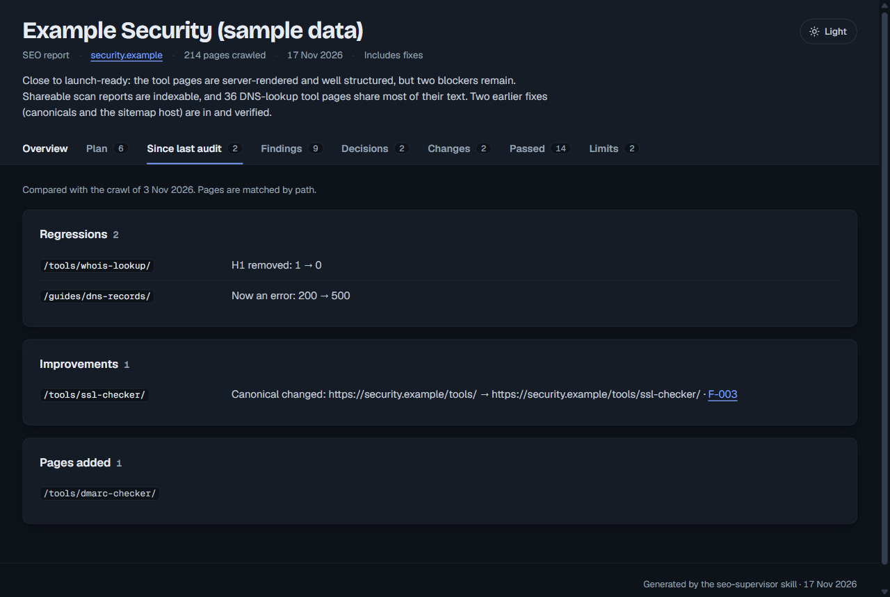
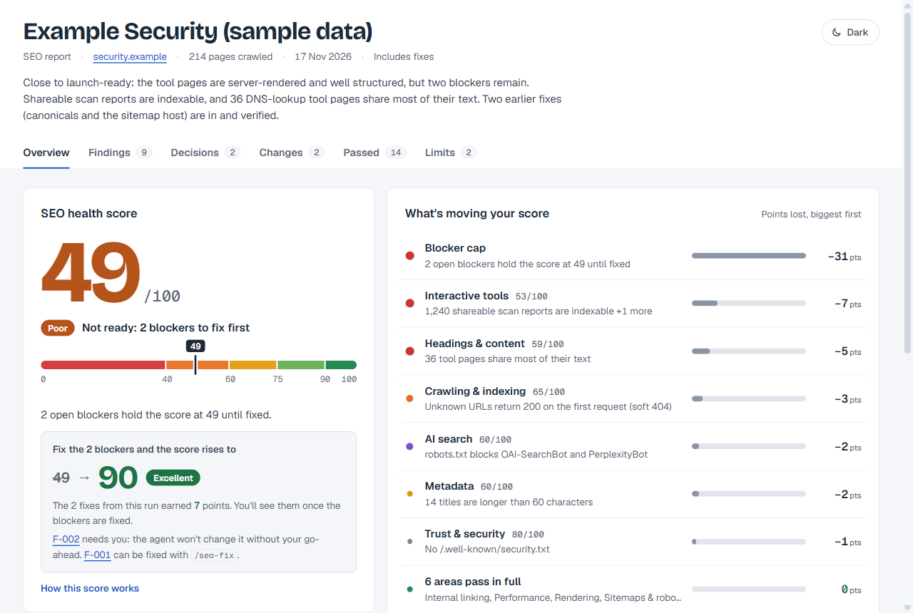
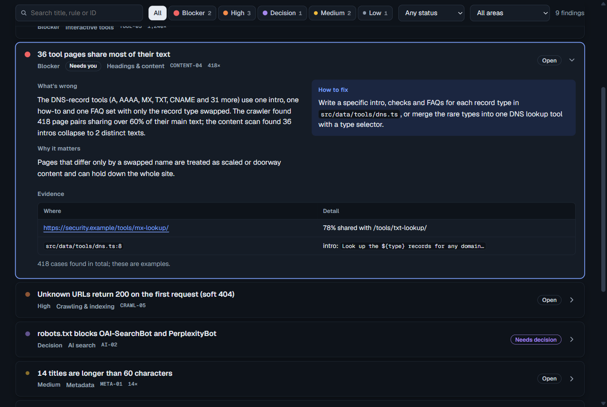

<h1 align="center">SEO Supervisor</h1>

<p align="center">
  <b>Audits, fixes and guards your site's SEO from inside your coding agent, and never touches your content without asking.</b>
</p>

<p align="center">
  <a href="https://github.com/m-zaman-khan/seo-supervisor/actions/workflows/ci.yml"></a>
  <a href="https://www.npmjs.com/package/seo-supervisor"></a>
  <a href="LICENSE"></a>
  
  
</p>

<p align="center">
  <a href="https://m-zaman-khan.github.io/seo-supervisor/"><b>See a live sample report →</b></a>
</p>

<p align="center">
  
</p>

SEO Supervisor is a skill for Claude Code and other coding agents. It crawls your site the way Google does and checks it against 163 current SEO rules. Then it gives you one clear report: a 0–100 score, every problem with its evidence, and what to do first.

Then it fixes what can safely be fixed in code, re-checks each fix, and tells you plainly what only you can fix.

```bash
npx seo-supervisor        # then, in Claude Code: /seo-audit
```

## Contents

- [What's new in 2.0](#whats-new-in-20)
- [Install](#install)
- [Commands](#commands)
- [Starting from zero](#starting-from-zero)
- [The report](#the-report)
- [Optional: outside checks and Search Console](#optional-outside-checks-and-search-console)
- [What it checks](#what-it-checks)
- [Safe by default](#safe-by-default)
- [Tested](#tested)
- [Updating](#updating)
- [FAQ](#faq)

## What's new in 2.0

- **Since last audit.** Each audit compares itself with the previous crawl and lists what got worse (a page now noindex, a lost H1, a new error) and what got better.
- **Deeper checks:** hreflang, document basics, meta refresh, robots header conflicts, image weight and format, shop merchant-listing schema, Content-Signal, Markdown for agents and the llms.txt format.
- **Live HTTPS checks** with `--check-live`: certificate trust, hosts and time left, the http→https redirect and HSTS. A certificate blocker fails `/seo-launch`.
- **Real-world data, only if you switch it on:** real-user Core Web Vitals from Google PageSpeed Insights, and a headless Chrome render that shows what your JavaScript changes.
- **Search Console:** drop your Performance export into `seo-audit/` and findings show their clicks, with new findings for low click rates, pages almost on page one and pages competing for one query.
- **Search intent and briefs:** checks whether a page is the kind of page that ranks for its phrase, and the new `/seo-brief` writes a content brief.
- **Free tools that need no account:** a share-image generator using your own Chrome, IndexNow pings to Bing and others, an offline structured-data checker with optional git, CI and agent hooks, and a server-log scan that shows what search and AI crawlers really get.
- **A fairer score:** a site whose pages all share a default title, or have no H1 or canonical, now scores as Poor instead of Good.
- **Speed you can act on:** which part of the main image's load is slow, with the fix for that part, and "Since last audit" says when a page got slower. Plus checks for next-page preloading, instant Back and Forward, and oversized pages.
- **More connections and checks:** Matomo and PostHog visits, a check that your known backlinks still exist, Google ranking updates next to your numbers, Lighthouse on every page if you want it, and "Since last audit" now notices schema that lost fields.

## Install

Pick **one** of these per machine.

**Claude Code plugin**

```text
/plugin marketplace add m-zaman-khan/seo-supervisor
/plugin install seo-supervisor@seo-supervisor
```

Claude Code puts the plugin name in front of plugin commands, so they appear as `/seo-supervisor:seo-audit` and so on.

**One command with npx** (any agent)

```bash
npx seo-supervisor
```

It asks two things:

1. **Install for:** you, in every project, or this project only (to commit for your team).
2. **Which agents:** a checklist of 20 coding agents, including Claude Code, Codex, Cursor, Windsurf, Gemini CLI, GitHub Copilot, OpenCode, Grok, Cline and Kiro. The agents installed on your machine are found and ticked for you.

```text
? Which agents? (space to select, a for all, enter to confirm)
❯ ◉ Claude Code          found · ~/.claude/skills
  ◉ Codex                found · ~/.agents/skills
  ◉ Cursor               found · ~/.cursor/skills
  ◯ Windsurf             ~/.codeium/windsurf/skills
  …
```

The skill goes into each agent's own skills folder, and agents that share a folder get one copy. Claude Code also gets the `/seo-audit`, `/seo-fix`, `/seo-review`, `/seo-launch`, `/seo-setup` and `/seo-brief` commands. In other agents, ask them to "audit the SEO of this site". The installer only ever replaces or removes its own files.

For scripts and CI, use flags to skip the questions:

```bash
npx seo-supervisor --agent claude-code,cursor --scope project   # those agents, in this project
npx seo-supervisor --yes                                        # the agents it finds, for you
npx seo-supervisor --uninstall                                  # remove it again
```

`npx seo-supervisor --help` lists every agent key. Using an agent that isn't on the list? `npx skills add m-zaman-khan/seo-supervisor` covers 40+ more.

Needs Node 22 or newer. There's nothing else to install: zero dependencies, plus one optional add-on. The installer offers **Lighthouse** (about 170 MB, kept in `~/.seo-supervisor/tools`, never in your project) for real Performance, SEO, Accessibility and Best practices scores; add it later with `npx seo-supervisor --with-lighthouse`. Every key or account is optional too: see [Optional: outside checks and Search Console](#optional-outside-checks-and-search-console).

## Commands

| Command | What it does | Edits anything? |
| --- | --- | --- |
| `/seo-audit [url]` | Crawls a production build of your site, inspects the code and the content data, and writes the report to `seo-audit/` | Never |
| `/seo-fix [F-001 F-004]` | Fixes the named findings, or all open ones, at the root (the shared metadata helper, sitemap or layout), re-checks each fix and updates the report | Only what you approved |
| `/seo-review [PR or branch]` | Finds the SEO problems a change introduces: a lost canonical, an accidental noindex, a dropped H1, made-up ratings… | Never |
| `/seo-launch [url]` | A pass/fail gate before you switch indexing on, plus the launch-day checklist | Never |
| `/seo-setup [url]` | For a site with **no SEO yet**: proposes a full SEO plan, then builds it once you approve | Only after you approve the plan |
| `/seo-brief [topic or URL]` | Writes a content brief: intent, phrases, outline, questions to answer, the facts it needs from you, and internal links | Never (writes only `seo-audit/briefs/`) |

## Starting from zero

New site, or an old app that never had any SEO? Run `/seo-setup`. It plans first instead of handing you 60 problems:

1. **It works out what your site is** from your own pages and routes. A landing page, a SaaS app, a blog, a shop, a portfolio and a local business each get a different plan, and none of them get pages they don't need.
2. **It proposes the plan on a Plan tab.** That covers every page's title, description, H1, schema, target search phrase and links. Big sets like posts or products get one template instead of thousands of rows. New pages are proposed only where your site shows a gap, such as a missing `/docs` parent or a privacy page your forms need.
3. **You approve it.** Risky changes are listed separately under **Needs your yes**, and each one needs its own yes: a domain change, robots, AI crawlers, anything in your CMS.
4. **It builds the foundation and fixes the rest.** First the metadata helper, sitemap, robots, schema, headings, breadcrumbs and internal links. Then the other code problems the audit found, such as forms, results output, rendering and speed. Those are listed in the plan, so you approve them too. It drafts any copy you still need to approve, with visible placeholders instead of invented facts.
5. **It proves it with an audit:** the score before and after, and what's still waiting for you.

Run `/seo-setup` again at any point and it continues where it stopped.

<p align="center">
  
</p>

## The report

One HTML file that works offline. It opens in dark mode and has a light-mode switch, and it comes with a Markdown twin that holds every detail.

- **A 0–100 health score with area scores,** and the points each area loses, so you know where to start.
- **"Fix the blockers and the score rises to 90."** A blocker caps the score, and the report shows what fixing it unlocks.
- **"Needs you."** Anything only the owner can do (content, CMS edits, business decisions) is labelled, so it's clear what the agent will and won't change.
- **Tabs for Findings, Decisions, Changes, Passed and Limits,** plus **Since last audit** from the second audit on. Every finding says what's wrong, why it matters, how to fix it, and gives the evidence: URLs, files and line numbers.
- **Traffic and speed when you have them:** Search Console clicks on the findings and plan rows they concern, and one line of real-user speed on the Overview.

<p align="center">
  
</p>

<p align="center">
  
  
</p>

## Optional: outside checks and Search Console

**Outside checks are off until you say yes.** The agent asks once per project and remembers your answer in `seo-audit/settings.json`. Saying yes allows these:

| Check | What leaves your machine |
| --- | --- |
| Real-user speed (Core Web Vitals) | Up to 10 public page URLs, sent to Google PageSpeed Insights (needs `PSI_API_KEY`) |
| Lighthouse scores (only if you added Lighthouse) | Nothing is sent by the skill, but the sample pages load in your Chrome and run their own scripts. 5 pages by default; `--lighthouse all` covers every page (up to 200, about 20 seconds each) |
| What your JavaScript changes, how pages look on a phone, and whether Back and Forward are instant | Nothing is sent by the skill, but up to 10 pages run in a headless Chrome or Edge, so their own scripts (analytics included) run. Screenshots are saved locally |
| Search intent | Your pages' target phrases, sent to the agent's web search provider |
| Off-site brand presence | Your brand name, sent to the agent's web search provider |
| Google ranking updates in the period, so you can tell a drop that came with a Google update from one your site caused | Nothing about your site: a plain read of Google's public Search Status Dashboard |

A few more things reach out, each only after its own yes:
- **IndexNow** sends the URLs of changed pages to api.indexnow.org.
- **The backlink check** visits the pages that link to you, to see if the links are still there. Useful after a redesign or a move.
- **The connections** below send your site's address and domain names to Google, Bing, Open PageRank or Ahrefs, or to your own Matomo or PostHog.

To switch them on for one run, say so: `/seo-audit with outside checks`. Real-user speed needs a free PageSpeed Insights API key from Google Cloud in `PSI_API_KEY`: Google refuses almost all requests without one. The render and intent checks need no key. Add `CRUX_API_KEY` too and the Overview shows whether real-user speed got better or worse over the last 25 weeks, and which part of the main image's load real visitors wait on. With outside checks off, these checks are listed under the report's Limits.

**Connect your accounts (optional).** In `/seo-setup` and `/seo-fix` the agent offers each connection once, and you can say no:
- **Google Search Console and Analytics:** "Sign in with Google" in your browser, or set up your own Google client in a few guided steps. Read-only. It adds your real queries and clicks, "is this page in Google" for key pages, sitemap errors and organic visits, next to Bing's numbers on each page. The one write action is optional: `google.mjs submit-sitemap` submits your sitemap only when you say yes, and asks Google for that permission only then. Remove access any time at myaccount.google.com/connections, or with `google.mjs disconnect`.
- **Bing Webmaster Tools, Open PageRank and Ahrefs' free Domain Rating:** paste a free API key at a hidden prompt in your own terminal. They add Bing data, the pages other sites link to, and authority scores next to your competitors'.
- **Matomo or PostHog:** offered only if your site uses one. It adds visits from search engines to each page, from your own analytics. `connect-keys.mjs guide matomo` (or `posthog`) shows where to find each value; `set matomo` asks for them, with the token at a hidden prompt.

Logins and keys stay in `~/.seo-supervisor/` on your computer, never in your project. Anything you skip is listed under Limits and doesn't lower your score.

**Search Console data stays local.** Export Performance → Pages (and Queries) from Search Console, unzip it into `seo-audit/`, and run `/seo-audit`. For pages competing for one query, also export each important page's queries (filter by page, then export) into its own folder under `seo-audit/page-queries/`.

## What it checks

**119 core rules**, up to date as of November 2026:

| Area | Rules | Examples |
| --- | ---: | --- |
| Crawling & indexing | 12 | robots.txt, noindex, soft 404s, status codes, redirect chains, AI crawlers |
| URLs & canonicals | 9 | one URL per page, trailing slashes, canonicals on the right host, old URLs with 301s |
| Rendering | 10 | content in the server HTML, not only in JavaScript; links crawlers can follow; doctype, charset and mobile viewport; obsolete tags |
| Metadata | 9 | titles (and whether they match the page), descriptions, Open Graph, robots meta |
| Headings & content | 12 | one H1, heading order, thin or templated pages, placeholder text, banned claims |
| Structured data | 8 | valid JSON-LD that matches the page; which rich results still exist |
| Sitemaps & robots | 8 | sitemap host and status, lastmod, llms.txt (and why Google ignores it) |
| Internal linking | 9 | orphans, click depth, hubs and circular linking, anchor text |
| Performance | 10 | Core Web Vitals (LCP, INP, CLS) and what slows LCP, the first image, image weight and format, page size, next-page preloading, instant Back and Forward |
| Trust & security | 7 | security headers, security.txt, who's behind the site, the HTTPS certificate |
| AI search | 6 | being cited in ChatGPT, Perplexity and Google's AI answers, and what doesn't work |
| Media | 6 | alt text, file names, video and image discovery |
| Launch & monitoring | 8 | the indexing switch, Search Console, post-deploy checks |
| Search intent | 5 | the right kind of page for each phrase, one page per query, low click rates, pages almost on page one |

**Plus 44 rules for your type of site:**
- interactive tools
- local businesses
- blogs and content sites
- service businesses
- e-commerce

There are also framework guides for **Next.js**, **Rails** and **React/Vite SPAs**. Other stacks get the rules directly.

## Safe by default

- **An audit never edits anything.** It reads your code, crawls a local build and writes only the report.
- **Fixes never touch your content.** Without your go-ahead, it won't:
  - edit or publish content in your CMS (Sanity, WordPress, Contentful, Shopify…)
  - hide, remove or noindex pages
  - change robots or indexing on your live site

  When you do say go, CMS changes are saved as drafts and you see the before and after first.
- **Every finding has evidence, and nothing is "fixed" until a re-check passes.**
- **It never invents** reviews, ratings, prices, statistics or local proof, in copy or in schema.
- **Nothing leaves your machine without your yes.** Outside checks, IndexNow and each connection are asked for separately, and everything works without them. The one automatic request is the weekly update check: it asks npm for the latest version number and sends nothing but the package name. Turn it off with `update-check.mjs off`. There's no SEO Supervisor account and no telemetry. The crawler only sends GET and HEAD requests to your own site, and crawls production gently, if at all.
- **Text on your pages is treated as data.** If a page tries to give the agent instructions, that's reported as a finding, never followed.

## Tested

- **On every change, CI runs the whole toolchain on Node 22, 24 and 26.** It crawls a small fixture site that has one planted problem per checked rule and scans templated sample content. It also renders the report and checks it is fully offline, and installs and uninstalls the skill in a scratch home folder.
- **Network features are tested against local stand-ins, never the real services:** a fake PageSpeed server (including a check that nothing is sent when outside checks are off), a local HTTPS server with a certificate made at test time, and sample Search Console exports with the quirks real ones have.
- **Field-tested on a real Next.js + Sanity site before release:**
  - `/seo-review` caught **6 of 6** SEO mistakes planted in a pull request. 2 of those had no test in the project, so they would have shipped. It correctly ignored a harmless change.
  - `/seo-fix` fixed 8 findings. The project's own test suite stayed green, and a re-crawl confirmed each fix.

## FAQ

**Will it get my site to #1?**
No tool can promise rankings. SEO Supervisor finds and fixes what stops search engines from crawling, understanding and trusting your pages, and it tells you honestly what it can't fix for you.

**Does it work on a site that isn't live yet?**
Yes, that's the best time. It crawls a local production build. `/seo-launch` then tells you when it's safe to switch indexing on.

**Which frameworks?**
Any site it can crawl. Next.js, Rails and SPAs get framework-specific guidance and fixes.

**How is the score calculated?**
Every checked rule is worth 10 points. Open problems earn fewer points, the worse they are. Each open blocker caps the total at 59, 49, 39 and so on. The full model is in [`report-format.md`](skills/seo-supervisor/report-format.md).

## Updating

The agent tells you when a new version is out: at most once a week it asks npm for the latest version number (only the package name is sent) and mentions it once. It never updates anything by itself. To update:
- **Installed with `npx`:** run `npx seo-supervisor@latest` again. Keep the `@latest`, or npx may reuse an old cached copy.
- **Installed as a Claude Code plugin:** update it from Claude Code's `/plugin` menu.

Your logins, keys and settings in `~/.seo-supervisor/` and your reports in `seo-audit/` stay as they are. To turn the notices off, run `node <skill folder>/scripts/update-check.mjs off` (or set `SEO_SUPERVISOR_NO_UPDATE_CHECK=1`); they're also off in CI.

## Contributing

Search changes every month, so rule updates with a primary source are the most useful contribution. See [CONTRIBUTING.md](CONTRIBUTING.md). Run the tests with `npm test`.

## License

[MIT](LICENSE). The schema checker's vocabulary comes from Schema.org (CC BY-SA 3.0); see [NOTICE](NOTICE). The bundled report fonts (Geist, Geist Mono and Bricolage Grotesque) are under the SIL Open Font License.
