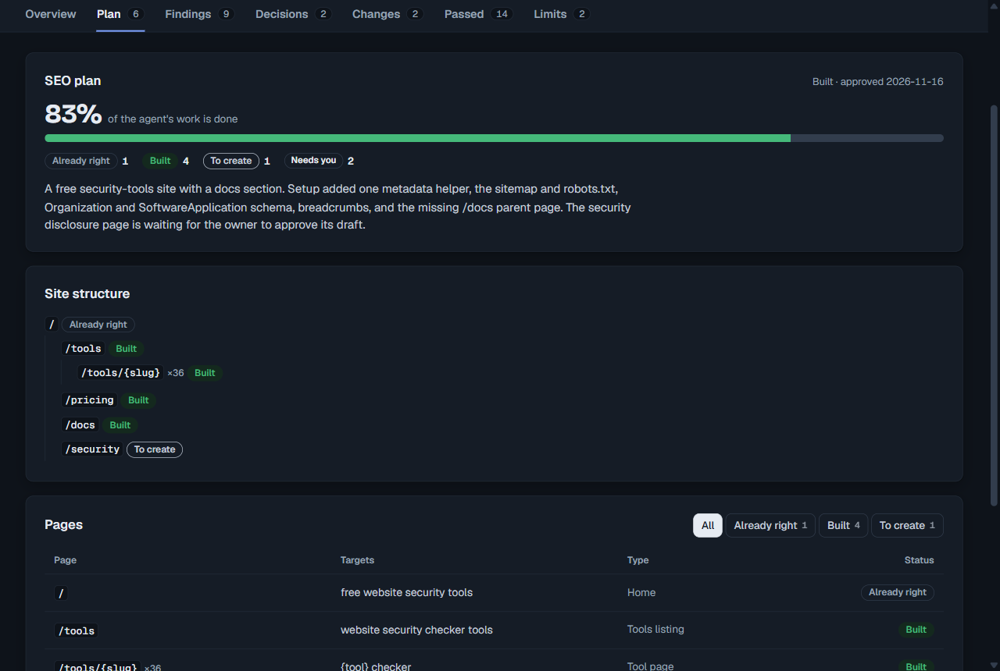

<p align="center"></p>

<h1 align="center">SEO Supervisor</h1>

<p align="center">
  <b>Audits, fixes and guards your site's SEO from inside your coding agent, and never touches your content without asking.</b>
</p>

<p align="center">
  <a href="https://github.com/m-zaman-khan/seo-supervisor/actions/workflows/ci.yml"></a>
  <a href="https://www.npmjs.com/package/seo-supervisor"></a>
  <a href="LICENSE"></a>
  
  
</p>

<p align="center">
  <a href="https://m-zaman-khan.github.io/seo-supervisor/"><b>See a live sample report →</b></a>
</p>

<p align="center">
  
</p>

SEO Supervisor is a skill for Claude Code and other coding agents. It crawls your site the way Google does and checks it against 171 current SEO rules. Then it gives you one clear report: a 0–100 score, every problem with its evidence, and what to do first.

Then it fixes what can safely be fixed in code, re-checks each fix, and tells you plainly what only you can fix.

```bash
npx seo-supervisor        # then, in Claude Code: /seo-audit
```

## Contents

- [What's new in 2.0](#whats-new-in-20)
- [Install](#install)
- [Commands](#commands)
- [Starting from zero](#starting-from-zero)
- [The report](#the-report)
- [Optional: outside checks and Search Console](#optional-outside-checks-and-search-console)
- [What it checks](#what-it-checks)
- [Safe by default](#safe-by-default)
- [Tested](#tested)
- [Updating](#updating)
- [FAQ](#faq)

## What's new in 2.0

- **Since last audit.** Each audit compares itself with the previous crawl and lists what got worse (a page now noindex, a lost H1, a new error) and what got better.
- **Deeper checks:** hreflang, document basics, meta refresh, robots header conflicts, image weight and format, shop merchant-listing schema, Content-Signal, Markdown for agents, and a missing or malformed llms.txt.
- **Live HTTPS checks** with `--check-live`: certificate trust, hosts and time left, the http→https redirect and HSTS. A certificate blocker fails `/seo-launch`.
- **Real-world data, only if you switch it on:** real-user Core Web Vitals from Google PageSpeed Insights, and a headless Chrome render that shows what your JavaScript changes.
- **Search Console:** drop your Performance export into `seo-audit/` and findings show their clicks, with new findings for low click rates, pages almost on page one and pages competing for one query.
- **Search intent and briefs:** checks whether a page is the kind of page that ranks for its phrase, and the new `/seo-brief` writes a content brief.
- **Free tools that need no account:** a share-image generator using your own Chrome, IndexNow pings to Bing and others, an offline structured-data checker with optional git, CI and agent hooks, and a server-log scan that shows what search and AI crawlers really get.
- **A fairer score:** a site whose pages all share a default title, or have no H1 or canonical, now scores as Poor instead of Good.
- **Speed you can act on:** which part of the main image's load is slow, with the fix for that part, and "Since last audit" says when a page got slower. Plus checks for next-page preloading, instant Back and Forward, and oversized pages.
- **More connections and checks:** Matomo and PostHog visits, a check that your known backlinks still exist, Google ranking updates next to your numbers, Lighthouse on every page if you want it, and "Since last audit" now notices schema that lost fields.
- **Search Console in more depth:** image, video, news and Discover clicks, clicks by device and country, the change from the period before with the pages that dropped most, and the rich-result errors Google reports. It also warns when a period overlaps a data problem Google has documented.
- **Fewer blind spots:**
  - Gzipped and plain-text sitemaps are read; a broken sitemap is reported with its line, and an empty one or a relative `<loc>` is flagged.
  - robots `none` counts as noindex.
  - Tests the www/bare-domain redirect, and compares what Googlebot gets with what visitors get.
  - Checks the favicon and your phone number and address on the page.
  - Business Profile, Bing Places and Apple Business guidance for local businesses.
- **Trust and the right schema:**
  - A Trust signals (E-E-A-T) view on the Site & content tab, for example "73/100 · 8 of 11 found", listing what to add. It's SEO Supervisor's own check, not a Google score, and it never changes your health score.
  - The Local SEO and Content quality views show the existing area scores under clearer names.
  - The crawler recognises 48 kinds of business (restaurants, clinics, trades, salons, hotels, shops, schools, publishers…), flags a schema that's too general, and asks you when two types fit.
- **Free backlink view:** export Search Console's three Links tables into `seo-audit/links/`. The Links tab then shows how many sites link to you, your most-linked pages and the mix of link text. If linking sites fall by 30% and at least 10, "Since last audit" says so. There are no toxic-link scores, because Google discounts spam links itself.
- **Writing and AI agents:**
  - Writing notes on English pages point out long sentences, long paragraphs and stock phrases. They're information only.
  - Form fields and buttons with no name are flagged, since screen readers and browsing AI agents both need those names.
  - An AI agents note lists WebMCP tools, a UCP shop profile and agent files when a site has them.
- **More rich results and small checks:**
  - The schema checker knows every rich-result type in Google's search gallery, flags retired ones, and `examples/snippets.md` has copy-ready code for each.
  - Desktop speed with good / needs improvement / poor bands, and INP and CLS in "Since last audit".
  - Small checks: sitemap duplicates and nested indexes, unencoded links, images without `srcset` or lazy loading, repeated head tags, cookie flags, short HSTS, old TLS versions, and tap targets on phones.
  - `page-types.md` gives a checklist per page type.
- **Languages, images and deeper comparisons:**
  - hreflang is read from the page, the HTTP `Link` header and the sitemap, as one set. The skill flags missing language versions, untranslated copies, `lang` tags that don't match, and the Google Translate widget used as a site's only translation.
  - An "Images by possible saving" table, and `images.mjs` to convert heavy images to WebP or AVIF with an optional add-on, only with your yes.
  - "Since last audit" also shows robots.txt changes, pages leaving or joining the sitemap, pages losing internal links, and changed redirects. Pages other sites link to that now break are flagged.
  - With `--render all`, every page is tested in a browser, up to 200, not just 10. Form fields that iPhones zoom into are flagged, and Lighthouse keeps every failed audit with the files behind it.
  - Matomo and PostHog visits by device and country, and an optional Bing URL submission.
- **Grow, rewrite and know your audience:**
  - `/seo-grow` turns your own data into an ordered to-do list for more visitors: who visits, what they search for, quick wins, and when to check the results.
  - `/seo-rewrite` rewrites a page in plain words, paragraph by paragraph. You see before and after, and nothing changes without your yes. No API needed: your own agent does it.
  - Keyword ideas (`keyword-ideas.mjs`) from your own Search Console queries and crawl: queries almost on page one, queries no page is about, and real questions. With outside checks on, phrases from search results are added, each with its source. No made-up volumes, and you pick the targets.
  - Audience check: name up to 4 audiences in the profile, and the report lists what each key page gives them and what's missing, with evidence from the page. No score, and no invented personas.
  - Links worth a look, and a disavow helper. The Links panel lists links that stand out, with what to check, and no score. `disavow.mjs` writes a disavow file from the domains you pick, keeping your old list, for you to upload. It's only for real cases, such as a manual action or links you bought.
  - Share previews: a share image without `twitter:card` (X then shows at most a small card), and a `twitter:card` value X doesn't define.
- **Security, crawling and structured data:**
  - TRUST-01 also checks:
    - how strong the content security policy is
    - Permissions-Policy
    - HSTS that browsers ignore or that leaves out subdomains, and preload readiness
    - mixed content in the head and in media
    - server versions with known critical holes
  - Headless Chrome and Lighthouse can't reach private or cloud-metadata addresses. Secrets, home folders and emails are masked in findings and notes.
  - The crawler:
    - reads RSS and Atom sitemaps and `/wp-sitemap.xml`
    - merges repeated and versioned robots.txt groups
    - reads the one group Googlebot obeys (its own, else `*`)
    - waits when a site says "too many requests" (429)
    - audits one section (`--include`, `--exclude`)
    - estimates the site's size past its page limit
    - compares Google's indexed count with its own
    - flags indexable pages with URL parameters, and malformed links
  - Schema: placeholder text left in JSON-LD, missing or empty `@type`, schema images that don't load, the deprecated Attorney type, and imprecise map coordinates.
- **Content and guides:**
  - Descriptions that barely match their page, end with the title's brand, or are templated across the site.
  - Stale guides, keyword-use verdicts, more claim patterns ("grew 40%", "3x faster") with a source check, and an opt-in reading-ease check for CI (your pass mark; SEO Supervisor's own check, not Google's).
  - New guides:
    - competitor analysis
    - a one-page intent review with a wireframe
    - a cluster map
    - fuller briefs
    - comparison, case-study, hybrid and language-version pages
    - publisher rules
- **Links and connections:**
  - New linking sites since the last export.
  - Pages no other site links to.
  - Reciprocal link swaps in "Worth a look".
  - Each backlink's target, text and nofollow.
  - Outbound link counts.
  - A free Common Crawl lookup.
  - Domain age from RDAP.
  - Optional Moz and YouTube keys.
  - Property totals and the "AI Assistant" channel from Google, more from Bing, Matomo and PostHog, and imports of Google's and Bing's AI reports.
- **Shops, images, phones, local, AI and the report:**
  - Shop checks for a missing product image, a price of 0, a price end date that has passed, a currency that isn't an ISO code, a stock status schema.org doesn't list, an "N/A" brand, unlabelled adult products and one H1 shared by many product pages. The report counts which products give a brand, GTIN, SKU, colour, size, material and category.
  - Image checks: weak alt text, extra image preloads, images over 500 KB, and a main image without `fetchpriority`. Image credits and AI labels are read from the files, and `images.mjs --label-ai` adds the AI label without re-encoding the image.
  - More real-user speed detail: the share of good and poor visits, FCP and TTFB, the data's period, 4-week averages, and tablet and home-page trends. Server response time per page, and Lighthouse on as many pages as you name.
  - With outside checks on, each sample page's desktop and phone loads are also read for: browser errors, text only JavaScript adds, what's on the first screen, the phone menu, ads, hidden text and jump links. Whole-page, 1920×1080 and tablet screenshots, and `--render-page` renders a page you pick.
  - Tells a storefront from a business that goes to its customers, and doesn't ask the second for a street address. With your yes, it adds nearby competitors and an address check from OpenStreetMap: free, no key.
  - A table of which AI crawlers robots.txt lets in, a check of where Content-Signal lines sit, and, with your yes, a test of whether a firewall turns AI search crawlers away. The log scan knows more Google, OpenAI and Meta bots, from the same list as the table, and can check visits against the vendors' published addresses.
  - "Since last audit" now covers H1 and H2 text, hreflang, more share tags, retired schema and shrunk sections. It keeps a timeline of every crawl and can run on a schedule.
  - A PDF report (`render-report.mjs --pdf`), a score per page, `npx seo-supervisor doctor` when something fails, `npx seo-supervisor dashboard` for several sites, and per-client logins for agencies (`SEO_SUPERVISOR_CLIENT`). `--with-browser` adds Chrome for containers and CI, and `--zip` makes a zip to upload to claude.ai (Customize → Skills, with code execution on).

## Install

Pick **one** of these per machine.

**Claude Code plugin**

```text
/plugin marketplace add m-zaman-khan/seo-supervisor
/plugin install seo-supervisor@seo-supervisor
```

Claude Code puts the plugin name in front of plugin commands, so they appear as `/seo-supervisor:seo-audit` and so on.

**One command with npx** (any agent)

```bash
npx seo-supervisor
```

It asks two things:

1. **Install for:** you, in every project, or this project only (to commit for your team).
2. **Which agents:** a checklist of 21 coding agents, including Claude Code, Codex, Cursor, Devin (formerly Windsurf), Gemini CLI, Antigravity, GitHub Copilot, OpenCode, Grok, Cline and Kiro. The agents installed on your machine are found and ticked for you.

```text
? Which agents? (space to select, a for all, enter to confirm)
❯ ◉ Claude Code          found · ~/.claude/skills
  ◉ Codex                found · ~/.agents/skills
  ◉ Cursor               found · ~/.cursor/skills
  ◯ Devin (formerly Windsurf)  ~/.config/devin/skills
  …
```

The skill goes into each agent's own skills folder, and agents that share a folder get one copy. Each agent also gets what it supports:
- **The `/seo-audit`, `/seo-fix`, `/seo-review`, `/seo-launch`, `/seo-setup`, `/seo-brief`, `/seo-rewrite`, `/seo-grow`, `/seo-watch` and `/seo-connect` commands:** Claude Code, OpenCode, Roo Code, Augment and Gemini CLI. Most other agents show the skill itself as `/seo-supervisor`. In any agent you can also just ask in plain words: "audit the SEO of this site", "did my change help?", "is my setup OK?".
- **Subagents** (`seo-auditor`, `seo-reviewer`): Cursor, OpenCode and GitHub Copilot (and the Claude Code plugin).
- **The guard hook** ([below](#the-guard)): Codex, Cursor, GitHub Copilot, Devin and Cline (and the Claude Code plugin). It's added next to any hooks you already have. Codex runs it once you trust it in `/hooks`. Cline runs it in its CLI, SDK and Kanban only: its VS Code and JetBrains extensions don't run plugins yet. `--no-guard` leaves it out.

The installer only ever replaces or removes its own files, and `--uninstall` also removes the folders it made, once they're empty.

For scripts and CI, use flags to skip the questions:

```bash
npx seo-supervisor --agent claude-code,cursor --scope project   # those agents, in this project
npx seo-supervisor --yes                                        # the agents it finds, for you
npx seo-supervisor --agent cursor --no-guard                    # without the guard hook
npx seo-supervisor --uninstall                                  # remove it again
```

`npx seo-supervisor --help` lists every agent key. Using an agent that isn't on the list? `npx skills add m-zaman-khan/seo-supervisor` covers 40+ more.

Needs Node 22 or newer. There's nothing else to install: zero dependencies, plus two optional add-ons, both kept in `~/.seo-supervisor/tools`, never in your project:
- **Lighthouse** (about 170 MB) gives real Performance, SEO, Accessibility and Best practices scores. The installer offers it; add it later with `npx seo-supervisor --with-lighthouse`.
- **sharp** (about 20 MB) converts heavy images to WebP or AVIF. The installer doesn't ask about it; fix mode offers it when it finds heavy images, or add it with `npx seo-supervisor --with-image-tools`.

Every key or account is optional too: see [Optional: outside checks and Search Console](#optional-outside-checks-and-search-console).

## Commands

| Command | What it does | Edits anything? |
| --- | --- | --- |
| `/seo-audit [url]` | Crawls a production build of your site, inspects the code and the content data, and writes the report to `seo-audit/`. Give a page's URL to check just that page. Ends by offering connections, GitHub issues, the AI answer check and, for local businesses, the geo-grid | Never |
| `/seo-fix [F-001 F-004]` | Fixes the named findings, or all open ones, at the root (the shared metadata helper, sitemap or layout), re-checks each fix and updates the report. Asks first before CMS edits, removing or merging pages, live URLs, robots, and AI crawler rules | Only what you approved |
| `/seo-review [PR or branch]` | Finds the SEO problems a change introduces: a lost canonical, an accidental noindex, a dropped H1, made-up ratings… with a before/after crawl comparison and a structured data check | Never |
| `/seo-launch [url]` | A pass/fail gate before you switch indexing on, plus the launch-day checklist: IndexNow, a deploy check for CI, and the redirect checks for a site move | Never |
| `/seo-setup [url]` | For a site with **no SEO yet**: proposes a full SEO plan, then builds it once you approve | Only after you approve the plan |
| `/seo-brief [topic or URL]` | Writes a content brief: intent, phrases, outline, questions to answer, the facts it needs from you, and internal links | Never (writes only `seo-audit/briefs/`) |
| `/seo-rewrite [page, file, or "writing notes"]` | Rewrites a page's text in plain words, paragraph by paragraph, keeping facts, links and target phrases | Only what you say yes to |
| `/seo-grow [goal, page or audience]` | An ordered to-do list for more visitors, from your own data: who visits, what they search for, quick wins, and when to check the results, plus the ideas it left out and why | Never (writes only `seo-audit/grow-plan.md`) |
| `/seo-watch [change date or pages]` | What changed since the last audit, whether a change helped (changed pages against similar unchanged ones in Search Console), Google updates in the period, and a dashboard for several sites. Offers a deploy check for CI and scheduled runs | Never (writes only `seo-audit/watch/`) |
| `/seo-connect [service]` | Checks your setup first, then shows each data connection (Search Console, Bing, Clarity and the rest) and offers to connect the missing ones. Keys are typed at a hidden prompt, never in chat | Never |

Fix, rewrite and setup run only when you type them, never on Claude's own initiative. As a Claude Code plugin, each command pre-approves the scripts it runs, for that turn only, named one by one, and the ones that send or write outside (GitHub issues, IndexNow, AI answers, the geo-grid, sitemap submits) still ask.

### The guard

Before an AI agent does something risky for SEO, SEO Supervisor stops it and asks you: a script that contacts an outside service or writes to your accounts, a noindex, a robots.txt or AI crawler rule, a redirect change, a removed page or a changed canonical. Each question says what would happen, for example "Every page would drop out of Google." An API key pasted in chat is stopped before the AI sees it (except in Cline, which has no hook for that). A bare 32-character hex key, like Bing's or Matomo's, is caught when a word like "key" or "bing" sits just before it. Still, type keys only at `connect-keys.mjs set <service>`'s hidden prompt.

It comes with the Claude Code plugin, and the npx installer adds it to Codex, Cursor, GitHub Copilot, Devin and Cline (its CLI, SDK and Kanban; not yet its VS Code or JetBrains extension). Where the agent can show a yes/no box (Claude Code, Cursor's shell commands, Copilot CLI, Cline), you're asked there. Elsewhere the step is stopped with the reason, and the AI asks you in chat; if you say yes, do the step yourself, or set `"guard": "off"` in `seo-audit/settings.json` for that one step. Codex runs a new hook only after you trust it in `/hooks`.

It's on by default (ask). Switch it to block (the AI must ask you in chat) or off: in Claude Code with `/plugin configure seo-supervisor@seo-supervisor`, elsewhere with `SEO_SUPERVISOR_GUARD=block` or `"guard": "block"` in `seo-audit/settings.json`.

### What the Claude Code plugin adds

- **The guard,** as above.
- **A structured data check after each edit** of an HTML or JSON-LD file. Its errors go straight back to the AI.
- **A review reminder:** at the end of a session that changed SEO files, a one-time note suggests `/seo-review`.
- **Two subagents,** `seo-auditor` and `seo-reviewer`, that run an audit or a review in their own context and keep the crawl out of your chat (`@agent-seo-supervisor:seo-auditor`).
- **Two settings,** asked once when you enable the plugin: your site address (the default for audits) and the guard mode.

## Starting from zero

New site, or an old app that never had any SEO? Run `/seo-setup`. It plans first instead of handing you 60 problems:

1. **It works out what your site is** from your own pages and routes. A landing page, a SaaS app, a blog, a shop, a portfolio and a local business each get a different plan, and none of them get pages they don't need.
2. **It proposes the plan on a Plan tab.** That covers every page's title, description, H1, schema, target search phrase and links. Big sets like posts or products get one template instead of thousands of rows. New pages are proposed only where your site shows a gap, such as a missing `/docs` parent or a privacy page your forms need.
3. **You approve it.** Risky changes are listed separately under **Needs your yes**, and each one needs its own yes: a domain change, robots, AI crawlers, anything in your CMS.
4. **It builds the foundation and fixes the rest.** First the metadata helper, sitemap, robots, schema, headings, breadcrumbs and internal links. Then the other code problems the audit found, such as forms, results output, rendering and speed. Those are listed in the plan, so you approve them too. It drafts any copy you still need to approve, with visible placeholders instead of invented facts.
5. **It proves it with an audit:** the score before and after, and what's still waiting for you.

Run `/seo-setup` again at any point and it continues where it stopped.

<p align="center">
  
</p>

## The report

One HTML file that works offline. It opens in dark mode and has a light-mode switch, and it comes with a Markdown twin that holds every detail.

- **A 0–100 health score with area scores,** and the points each area loses, so you know where to start.
- **"Fix the blockers and the score rises to 90."** A blocker caps the score, and the report shows what fixing it unlocks.
- **"Needs you."** Anything only the owner can do (content, CMS edits, business decisions) is labelled, so it's clear what the agent will and won't change.
- **Action first:** the Overview shows the verdict and score, then **Fix first** (up to 5 things the agent can fix, each with a `/seo-fix F-012` line to copy) and **Needs you** (up to 3 owner tasks or decisions). Every finding ends with its next step.
- **The rest in tabs:** Findings and Decisions, then Search & AI, Speed, Links and Site & content, each only when it has data, then Since last audit (from the second audit on), Changes, Passed and Limits. Every finding says what's wrong, why it matters, how to fix it, and gives the evidence: URLs, files and line numbers.
- **How long each fix takes:** findings can say roughly whether a fix is quick, an hour or two, or half a day.
- **Traffic and speed when you have them:** Search Console clicks on the findings and plan rows they concern, with clicks and Core Web Vitals in the Overview's key numbers, and the detail on the Search & AI and Speed tabs.

<p align="center">
  
</p>

<p align="center">
  
  
</p>

## Optional: outside checks and Search Console

**Outside checks are off until you say yes.** The agent asks once per project and remembers your answer in `seo-audit/settings.json`. Saying yes allows these:

| Check | What leaves your machine |
| --- | --- |
| Real-user speed (Core Web Vitals) | Up to 10 public page URLs, sent to Google PageSpeed Insights (needs `PSI_API_KEY`) |
| Lighthouse scores (only if you added Lighthouse) | Nothing is sent by the skill, but the sample pages load in your Chrome and run their own scripts. Chrome's own background services are switched off. 5 pages by default; `--lighthouse 20` covers that many, and `--lighthouse all` every page (up to 200, about 20 seconds each) |
| What your JavaScript changes, how pages look on a phone, and whether Back and Forward are instant | Nothing is sent by the skill, but up to 10 pages run in a headless Chrome or Edge, so their own scripts (analytics included) run. Chrome's own background services (updates, sync, usage reports) are switched off, so Chrome itself contacts nothing. Screenshots are saved locally |
| Search intent | Your pages' target phrases, sent to the agent's web search provider |
| Off-site brand presence | Your brand name, sent to the agent's web search provider |
| Google ranking updates in the period, so you can tell a drop that came with a Google update from one your site caused | Nothing about your site: a plain read of Google's public Search Status Dashboard, and with `--blog` the Search Central blog's feed |

A few more things reach out, each only after its own yes:
- **IndexNow** sends the URLs of changed pages to api.indexnow.org.
- **The backlink check** visits the pages that link to you, to see if the links are still there. Useful after a redesign or a move.
- **Broken outgoing links** (`--outbound-links`) visits up to 100 other websites your pages link to, to find broken links. It's asked about separately, even when outside checks are on.
- **Desktop speed** (`--desktop`) sends the same sample URLs to Google PageSpeed again, for desktop. It's also asked about separately.
- **Testing every page in a browser** (`--render all`) runs every page's own scripts, analytics included, up to 200 pages. It's asked about separately, with the time it will take.
- **Bing URL submission** (`connect-keys.mjs submit-bing`) sends the URLs you choose to Bing Webmaster Tools, within Bing's daily quota. It only sends after your yes. IndexNow already tells Bing about changed pages.
- **hreflang on other sites** (`--hreflang-other-sites`) visits up to 20 of your language versions hosted on other sites, to check that they link back.
- **The AI crawler test** (`--ai-bot-probe`) asks up to 3 of your pages again as ChatGPT's, Claude's and Perplexity's search crawlers, to see whether a firewall turns them away.
- **Competitor analysis** visits a few pages on each competitor site you name.
- **Product copy lookup** sends one sentence from one product description to the agent's web search, to see whether it's copied from the maker.
- **OpenStreetMap** (`osm.mjs`) sends your business's address to OpenStreetMap to check it, and asks for similar businesses nearby. A service-area business's street is never sent.
- **Domain age** (`rdap.mjs`) sends your domain and any competitors' to their registries' public RDAP servers.
- **Common Crawl** (`commoncrawl.mjs`) asks Common Crawl's public index about your site and the pages that link to you. With `--rank` it also reads your domain's rank in Common Crawl's web graph, streaming up to 500 MB of its public rank file (nothing is stored).
- **Bot IP check** (`log-scan.mjs --verify-ips`) downloads the AI vendors' public IP lists. Nothing about your site is sent.
- **The browser add-on** (`npx seo-supervisor --with-browser`) downloads Chrome for Testing when no Chrome or Edge is installed.
- **The connections** below send your site's address and domain names to Google, Bing, Open PageRank, Ahrefs, Moz or YouTube. Matomo and PostHog get only your site or project ID and a request for search visits, sent to your own Matomo or PostHog server.

To switch them on for one run, say so: `/seo-audit with outside checks`. Real-user speed needs a free PageSpeed Insights API key from Google Cloud in `PSI_API_KEY`: Google refuses almost all requests without one. The render and intent checks need no key. Add `CRUX_API_KEY` too and the Speed tab shows whether real-user speed got better or worse over the last 25 weeks, and which part of the main image's load real visitors wait on. With outside checks off, these checks are listed under the report's Limits.

**Connect your accounts (optional).** Run `/seo-connect` any time. `/seo-audit`, `/seo-setup` and `/seo-fix` also offer each connection once, and you can say no:
- **Google Search Console and Analytics:** "Sign in with Google" in your browser, or set up your own Google client in a few guided steps. Read-only. It adds your real queries and clicks, "is this page in Google" for key pages, sitemap errors and organic visits, next to Bing's numbers on each page. The one write action is optional: `google.mjs submit-sitemap` submits your sitemap only when you say yes, and asks Google for that permission only then. Remove access any time at myaccount.google.com/connections, or with `google.mjs disconnect`.
- **Bing Webmaster Tools, Open PageRank and Ahrefs' free Domain Rating:** paste a free API key at a hidden prompt in your own terminal. They add Bing data, the pages other sites link to, and authority scores next to your competitors'.
- **Matomo or PostHog:** offered only if your site uses one. It adds visits from search engines to each page, and by device and country, from your own analytics. `connect-keys.mjs guide matomo` (or `posthog`) shows where to find each value; `set matomo` asks for them, with the token at a hidden prompt.
- **Microsoft Clarity:** offered only if your site uses it. It adds what real visitors did on each page in the last 3 days: sessions, scroll depth, quick backs (landing and going straight back), rage clicks and dead clicks. Only the token is sent. Clarity's heat maps and recordings stay in its own dashboard. `connect-keys.mjs guide clarity` shows where to make the token.

Logins and keys stay in `~/.seo-supervisor/` on your computer, never in your project. Anything you skip is listed under Limits and doesn't lower your score.

**Search Console data stays local.** Export Performance → Pages (and Queries) from Search Console, unzip it into `seo-audit/`, and run `/seo-audit`. For pages competing for one query, also export each important page's queries (filter by page, then export) into its own folder under `seo-audit/page-queries/`.

## What it checks

**124 core rules**, up to date as of November 2026:

| Area | Rules | Examples |
| --- | ---: | --- |
| Crawling & indexing | 12 | robots.txt, noindex, soft 404s, status codes, redirect chains, AI crawlers |
| URLs & canonicals | 9 | one URL per page, trailing slashes, canonicals on the right host, old URLs with 301s |
| Rendering | 11 | content in the server HTML, not only in JavaScript; links crawlers can follow; doctype, charset and mobile viewport; obsolete tags; phone menus and ads |
| Metadata | 10 | titles (and whether they match the page), descriptions, Open Graph, robots meta, the favicon in results |
| Headings & content | 13 | one H1, heading order, thin or templated pages, placeholder text, banned claims, plain language |
| Structured data | 8 | valid JSON-LD that matches the page; which rich results still exist |
| Sitemaps & robots | 8 | sitemap host and status, lastmod, llms.txt (and why Google ignores it) |
| Internal linking | 10 | orphans, click depth, hubs and circular linking, anchor text, earning links from other sites |
| Performance | 10 | Core Web Vitals (LCP, INP, CLS) and what slows LCP, the first image, image weight and format, page size, next-page preloading, instant Back and Forward |
| Trust & security | 7 | security headers, security.txt, who's behind the site, the HTTPS certificate |
| AI search | 6 | being cited in ChatGPT, Perplexity and Google's AI answers, and what doesn't work |
| Media | 7 | alt text, file names, video and image discovery, image credits and AI labels |
| Launch & monitoring | 8 | the indexing switch, Search Console, post-deploy checks |
| Search intent | 5 | the right kind of page for each phrase, one page per query, low click rates, pages almost on page one |

**Plus 55 rules for your type of site:**
- interactive tools
- local businesses
- blogs and content sites
- service businesses
- e-commerce

There are also framework guides for **Next.js**, **Rails** and **React/Vite SPAs**. Other stacks get the rules directly.

## Safe by default

- **An audit never edits anything.** It reads your code, crawls a local build and writes only the report.
- **Fixes never touch your content.** Without your go-ahead, it won't:
  - edit or publish content in your CMS (Sanity, WordPress, Contentful, Shopify…)
  - hide, remove or noindex pages
  - change robots or indexing on your live site

  When you do say go, CMS changes are saved as drafts and you see the before and after first.
- **A guard in your agent** asks you before risky steps, such as a noindex, a robots.txt or redirect change or a removed page. See [The guard](#the-guard).
- **Every finding has evidence, and nothing is "fixed" until a re-check passes.**
- **It never invents** reviews, ratings, prices, statistics or local proof, in copy or in schema.
- **Nothing leaves your machine without your yes.** Outside checks, IndexNow and each connection are asked for separately, and everything works without them. The one automatic request is the weekly update check: it asks npm for the latest version number and sends nothing but the package name. Turn it off with `update-check.mjs off`. There's no SEO Supervisor account and no telemetry. The crawler only sends GET and HEAD requests to your own site, and crawls production gently, if at all.
- **Text on your pages is treated as data.** If a page tries to give the agent instructions, that's reported as a finding, never followed.

## Tested

- **On every change, CI runs the whole toolchain on Node 22, 24 and 26.** It crawls a small fixture site that has one planted problem per checked rule and scans templated sample content. It also renders the report and checks it is fully offline, and installs and uninstalls the skill in a scratch home folder.
- **Network features are tested against local stand-ins, never the real services:** a fake PageSpeed server (including a check that nothing is sent when outside checks are off), a local HTTPS server with a certificate made at test time, and sample Search Console exports with the quirks real ones have.
- **Field-tested on a real Next.js + Sanity site before release:**
  - `/seo-review` caught **6 of 6** SEO mistakes planted in a pull request. 2 of those had no test in the project, so they would have shipped. It correctly ignored a harmless change.
  - `/seo-fix` fixed 8 findings. The project's own test suite stayed green, and a re-crawl confirmed each fix.

## FAQ

**Will it get my site to #1?**
No tool can promise rankings. SEO Supervisor finds and fixes what stops search engines from crawling, understanding and trusting your pages, and it tells you honestly what it can't fix for you.

**Does it work on a site that isn't live yet?**
Yes, that's the best time. It crawls a local production build. `/seo-launch` then tells you when it's safe to switch indexing on.

**Which frameworks?**
Any site it can crawl. Next.js, Rails and SPAs get framework-specific guidance and fixes.

**How is the score calculated?**
Every checked rule is worth 10 points. Open problems earn fewer points, the worse they are. Each open blocker caps the total at 59, 49, 39 and so on. While a problem you haven't marked won't fix is open, the score stops at 99, so 100 means nothing is left to fix. The full model is in [`report-format.md`](skills/seo-supervisor/report-format.md).

## Updating

The agent tells you when a new version is out: at most once a week it asks npm for the latest version number (only the package name is sent) and mentions it once. It never updates anything by itself. To update:
- **Installed with `npx`:** run `npx seo-supervisor@latest` again. Keep the `@latest`, or npx may reuse an old cached copy.
- **Installed as a Claude Code plugin:** update it from Claude Code's `/plugin` menu.

Your logins, keys and settings in `~/.seo-supervisor/` and your reports in `seo-audit/` stay as they are. To turn the notices off, run `node <skill folder>/scripts/update-check.mjs off` (or set `SEO_SUPERVISOR_NO_UPDATE_CHECK=1`); they're also off in CI.

## Behind a company proxy or in a container

**Behind a company proxy:**
- Set `NODE_USE_ENV_PROXY=1` alongside `HTTPS_PROXY`, `HTTP_PROXY` and `NO_PROXY` (Node 22.21+ or 24.5+). The scripts print a one-line reminder when a proxy is set without it.
- Chrome gets the same proxy through `--proxy-server` and `--proxy-bypass-list`. Proxy passwords aren't passed to Chrome.
- The live certificate check (`--check-live`) opens a direct connection that a proxy doesn't carry, so behind a proxy it may say the site can't be reached.

**Chrome in containers:** as root on Linux, or inside Docker, Podman or Kubernetes, Chrome runs with `--no-sandbox --disable-dev-shm-usage`, and the report says so. The site's scripts then run with fewer protections. To keep Chrome's sandbox, run as an ordinary user outside a container.

## Contributing

Search changes every month, so rule updates with a primary source are the most useful contribution. See [CONTRIBUTING.md](CONTRIBUTING.md). Run the tests with `npm test` (offline, about 40 s), and the Chrome tests with `npm run test:browser`.

## License

[MIT](LICENSE). The schema checker's vocabulary comes from Schema.org (CC BY-SA 3.0); see [NOTICE](NOTICE). The bundled report fonts (Geist, Geist Mono and Bricolage Grotesque) are under the SIL Open Font License.
