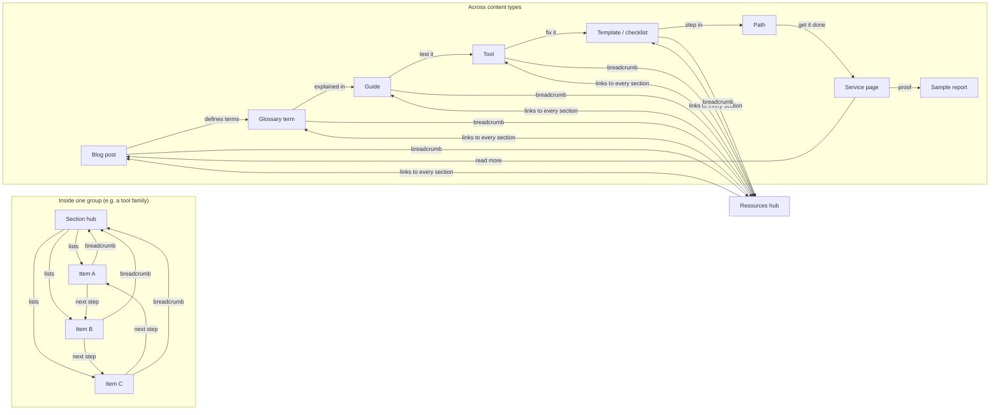

# Internal linking (LINK)

The goal: every page links **up** to its parent, **across** to its siblings and **forward** to the next useful step, and the forward links close into loops, so a visitor or crawler who lands anywhere can reach everything.

Inside each group, items chain into a loop. Across content types, each type points to the next and the money pages point back. A central hub links to every section, and every breadcrumb links back to it.

### LINK-01 · Hubs exist, and every page is within three clicks of home · high
- **Check:** crawler `deep-page` and the `depth` per page. Code: nav, footer, hub pages.
- **Pass:** home → section hubs → items. Each hub has an intro and links to everything in it. Groupings that aren't URLs (e.g. tool families) are sections with H2s on the hub.

### LINK-02 · No orphan pages · medium
- **Check:** crawler `orphan` (sitemap pages with no inbound internal links). Code: content-graph checks.
- **Pass:** every indexable page has at least one link from the **body** of another page. Sitemap, footer and menu links alone don't count.
- **Fix:** add the page to its hub and to the related blocks of its siblings. Add a build check that fails orphans.
- **Pages with one incoming link:** every whole-site crawl lists pages that can be indexed with exactly one other page linking to them (`linkedOnce`, the first 20; the home page aside). Information only: a page linked from one place is easy to miss, so link it from its hub or related pages too.
- **Internal link strength:** every whole-site crawl gives each indexable page a 0–100 strength (`linkStrength`), our own measure from the PageRank formula on the site's own links, not Google's PageRank. Information only: pages people find in search with little strength are worth links from the strongest pages.

### LINK-03 · Circular linking: up, across, forward, and across content types · high
- **Check:** code: related-content components and the data behind them. Content: a sample of pages of each type.
- **Pass:**
  - **Up:** breadcrumb plus the hub link.
  - **Across:** 3–6 siblings from the same group, both ways (adding an item updates its siblings).
  - **Forward:** 1–2 "next step" links. Chain each group so its last item points back to its first.
  - **Across types:** each content type points to the next one, ending at the pages that make money, which link back. A typical cycle: blog post → glossary term → guide → tool → template or checklist → path → service page → back to posts and guides. Local sites: service ↔ city ↔ nearby cities ↔ projects ↔ reviews. Shops: category ↔ product ↔ buying guide ↔ comparison.
  - **Comparisons:** each comparison page ("X vs Y", "alternatives to X") links to the other comparisons that share a product, both ways, and to the pages of the products it compares. A comparisons hub lists every comparison, grouped by product or category, and each comparison links back to it.
- **Fix:** generate these links from data (related, next and guide fields), never by hand.

### LINK-04 · Links point only at live pages · high
- **Check:** crawler `broken-internal-link`, `link-to-redirect`. Code: are generated links filtered through the set of published items?
- **Fix:** filter at render time, and add a build check that fails on links to unknown or unpublished slugs. Unreleased product or feature pages stay unlinked.

### LINK-05 · Anchor text says what the target is · low
- **Check:** crawler `generic-anchor`, and `link-no-text` (medium): an `<a href>` with no visible text, no `aria-label`, `aria-labelledby` or `title`, and no image alt, SVG `<title>` or label inside. A link marked `aria-hidden="true"` is left out, as axe and Lighthouse leave it out: screen readers skip it (the usual case is a card's image link next to its text link to the same page). Content: anchor variety.
- **Pass:** descriptive anchors ("check your DMARC record"). The same exact keyword isn't repeated on every link to a page; vary it naturally. Icon-only links (social icons, logo, cart) carry an `aria-label`.

### LINK-06 · Link blocks stay focused · low
- **Check:** crawler `too-many-links` (more than 150 per page).
- **Pass:** about 12–15 relevant contextual links on a content page, up to 6 siblings and 2 next steps. The footer links to hubs, not to every item. Nav doesn't list programmatic pages such as service × city.
- **Links to other sites:** every crawl counts them per page, and per site linked to (`linksToOtherSites` in seo-crawl.json), without visiting them. Information only: pages that make claims should link to their sources (CONTENT-10). Only `--outbound-links` visits them, to find broken ones (CRAWL-07).

### LINK-08 · An HTML sitemap page lists every hub and item · low
- **Check:** crawler pages for `/sitemap/` or similar. Code: footer link.
- **Pass:** a plain page linked from the footer that lists every hub, browse page and item, generated from the same data as the XML sitemap. It's a safety net for crawlers and for people who prefer scanning a list.

### LINK-09 · Defined terms link to their glossary entry once · low
- **Check:** content: guides, tool pages and posts that use glossary terms.
- **Pass:** the first mention of a term on a page links to its glossary entry, once per page, never every occurrence. Each glossary entry links back to the guide that explains it and the tool that tests it.

### LINK-07 · Browse pages and their items link both ways · medium
- **Check:** code: category, topic and tag pages.
- **Pass:** items link to their browse page (breadcrumb plus a "More in …" block). Browse pages link to every item, paginated. Tag pages exist only once there's enough volume.

### LINK-10 · Links from other sites are earned, never bought · medium
> Checked 19 Nov 2026 against developers.google.com/search/docs/essentials/spam-policies#link-spam; the link text and disavow notes on 20 Nov 2026 against support.google.com/webmasters/answer/2648487 (disavow) and developers.google.com/search/blog/2022/12/december-22-link-spam-update; the "Worth a look" list and the disavow file on 21 Nov 2026 against support.google.com/webmasters/answer/2648487, support.google.com/webmasters/answer/9044175 (manual actions) and Bing's notice that it removed its disavow tool (blogs.bing.com/webmaster/september-2023/Bing-Webmaster-Tools-to-Remove-Disavow-Links-Feature-in-October-2023); the link exchange quote, the Latest links and coverage notes, and the Common Crawl file sizes on 21 Nov 2026 against the spam policies page, support.google.com/webmasters/answer/9049606 and data.commoncrawl.org/projects/hyperlinkgraph/cc-main-2026-aug-sep-oct/index.html.

Google uses links from other well-known sites as one sign of quality, and for local businesses, as part of how well known the business is. Links worth having come from giving people a reason to link.
- **Check:** ask the owner how the site gets links. Search Console's Links report shows who links now; `links-import.mjs` reads its exports into the report.
- **Link text from other sites:** the report shows its mix: your brand, your web address, generic words like "click here", and other words. A natural mix is mostly brand, address and words that say what the page is about, because other people choose it. Google's spam policies count "links with optimized anchor text in articles, guest posts, or press releases distributed on other sites" as link spam, so never ask for keyword-rich link text. The mix is information only. Google publishes no target shares, so there are none here.
- **No "toxic links":** never score links or call them toxic. Google says that "in most cases, Google can assess which links to trust without additional guidance", and its SpamBrain systems neutralize unnatural links, so the credit they passed is simply lost.
- **Worth a look:** `links-import.mjs` lists links that stand out (`worthALook`), each with why it's listed and what to look at:
  - one site linking from 50 or more of its pages to 3 or fewer of yours, and 20% or more of all links. It's usually a footer or sidebar link: fine from a partner, worth a look from a site the owner doesn't know.
  - link text that's 75% or more descriptive words (not the brand, the address or generic words), from at least 10 texts. That's normal when people link to articles by their titles.
  - the same descriptive words from 3 or more sites in Bing's sample of links to the home page.
  - links that go both ways: 10 or more of the sites that link to you, and 10% or more of them, are sites your crawled pages link to (needs `--crawl`). That's normal between partners and suppliers. Google's spam policies count "Excessive link exchanges ("Link to me and I'll link to you") or partner pages exclusively for the sake of cross-linking" as link spam.

  These cut-offs are ours, not Google's. The list is information only: no score, no finding.
- **More link data, all information only** (the report's "More about links"):
  - **New linking sites:** with `--previous`, the sites in this Top linking sites export that the last one didn't list. An export holds 1,000 sites at most, so with 1,000 a "new" site may only have been past the cut before.
  - **No new links for 3 months or more:** Google's Latest links export lists "the most recently discovered links to your site ... sorted by discovery date". Its newest date is the latest a link in it can have been found, so a newest date 3 months or more before the export means no new link was found since. Keep "latest" in the file's name: More sample links has the same columns but is a sample.
  - **Pages no other site links to:** with `--crawl`, the indexable crawled pages missing from Top linked pages and Bing's linked pages. That's normal for most pages; link to the ones that matter from pages other sites do link to. Not listed when the export has 1,000 rows.
  - **The backlink check** (`backlinks.mjs`) records each link's target page, text and rel, a linking page that's nofollow as a whole (robots meta tag, or an X-Robots-Tag for every crawler or for googlebot), and the sites whose every link is nofollow, sponsored or ugc. Google says links marked this way "will generally not be followed" (developers.google.com/search/docs/crawling-indexing/qualify-outbound-links).
  - **Common Crawl** (`commoncrawl.mjs`, with the owner's `--yes`): whether the site is in Common Crawl's newest crawl, and whether its saved copies of known linking pages still link to the site. Its web graph, with each site's rank, is too big to download (the domain ranks alone are 2.4 GB), so ranks aren't read and it finds no linking site that isn't known already.
  - **How much this covers:** Google says the Links report "isn't a comprehensive list of every link on your site", and each table stops at 1,000 rows. Bing's sample covers links to the home page only. Treat the numbers as a sample, not a full count.
- **Disavow only for real cases:** a manual action for unnatural links, or links the owner knows were paid for or made to manipulate rankings, after asking the sites to remove them. Google says "most sites will not need to use this tool", and warns that a disavow done wrong "can potentially harm your site's performance in Google Search results". The owner picks every domain and page; `disavow.mjs` only writes the file, and the owner uploads it at search.google.com/search-console/disavow-links.
  - **The file:** a .txt file in UTF-8, one `domain:example.com` or full URL per line, `#` for comments, at most 100,000 lines and 2 MB, URLs up to 2,048 characters.
  - **An upload replaces the old list,** so the new file keeps every line of it (`--existing`).
  - **Properties:** the tool doesn't support Domain properties. A list applies to one URL-prefix property and its child properties, so http and https each need one.
  - **Subdomains:** Google doesn't say whether `domain:example.com` also covers its subdomains, so list each subdomain you mean.
  - **Not for dead pages:** links to the site's own 404 pages are fixed with redirects (URL-07), never disavowed.
  - **Bing** removed its disavow tool in October 2023.
- **Pass:** links come from:
  - **Something worth citing:** original data, a free tool, or a guide that answers a question better than anything else (AI-04).
  - **Digital PR with real news:** a study, a launch or a local first, sent to the journalists who cover it.
  - **Partners and suppliers:** the companies the business works with list it on their sites.
  - **Local press and associations:** local news, chambers of commerce and trade bodies (LOCAL-14).
  - **Unlinked mentions:** a site names the business without linking; ask it to add the link.
  - **Dead pages that have links:** redirect them to the closest live page, and ask the linking site to update the link (LAUNCH-05).
- **Never:** buying or selling links, sending free products in return for a link, large-scale link swaps or partner pages made only to cross-link, automated link building, or links hidden in widgets and footers on other sites. All are link spam under Google's spam policies. A paid link is fine only when it's marked `rel="sponsored"` or `rel="nofollow"`.
- These are owner actions: report them as notes.
