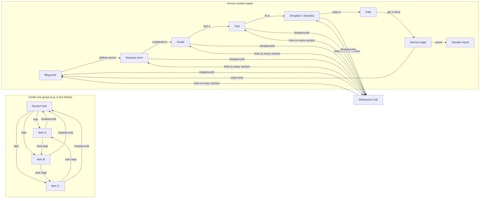

# Internal linking (LINK)

The goal: every page links **up** to its parent, **across** to its siblings and **forward** to the next useful step, and the forward links close into loops, so a visitor or crawler who lands anywhere can reach everything.

Inside each group, items chain into a loop. Across content types, each type points to the next and the money pages point back. A central hub links to every section, and every breadcrumb links back to it.

### LINK-01 · Hubs exist, and every page is within three clicks of home · high
- **Check:** crawler `deep-page` and the `depth` per page. Code: nav, footer, hub pages.
- **Pass:** home → section hubs → items. Each hub has an intro and links to everything in it. Groupings that aren't URLs (e.g. tool families) are sections with H2s on the hub.

### LINK-02 · No orphan pages · medium
- **Check:** crawler `orphan` (sitemap pages with no inbound internal links). Code: content-graph checks.
- **Pass:** every indexable page has at least one link from the **body** of another page. Sitemap, footer and menu links alone don't count.
- **Fix:** add the page to its hub and to the related blocks of its siblings. Add a build check that fails orphans.

### LINK-03 · Circular linking: up, across, forward, and across content types · high
- **Check:** code: related-content components and the data behind them. Content: a sample of pages of each type.
- **Pass:**
  - **Up:** breadcrumb plus the hub link.
  - **Across:** 3–6 siblings from the same group, both ways (adding an item updates its siblings).
  - **Forward:** 1–2 "next step" links. Chain each group so its last item points back to its first.
  - **Across types:** each content type points to the next one, ending at the pages that make money, which link back. A typical cycle: blog post → glossary term → guide → tool → template or checklist → path → service page → back to posts and guides. Local sites: service ↔ city ↔ nearby cities ↔ projects ↔ reviews. Shops: category ↔ product ↔ buying guide ↔ comparison.
- **Fix:** generate these links from data (related, next and guide fields), never by hand.

### LINK-04 · Links point only at live pages · high
- **Check:** crawler `broken-internal-link`, `link-to-redirect`. Code: are generated links filtered through the set of published items?
- **Fix:** filter at render time, and add a build check that fails on links to unknown or unpublished slugs. Unreleased product or feature pages stay unlinked.

### LINK-05 · Anchor text says what the target is · low
- **Check:** crawler `generic-anchor`, and `link-no-text` (medium): an `<a href>` with no visible text, no `aria-label`, `aria-labelledby` or `title`, and no image alt, SVG `<title>` or label inside. A link marked `aria-hidden="true"` is left out, as axe and Lighthouse leave it out: screen readers skip it (the usual case is a card's image link next to its text link to the same page). Content: anchor variety.
- **Pass:** descriptive anchors ("check your DMARC record"). The same exact keyword isn't repeated on every link to a page; vary it naturally. Icon-only links (social icons, logo, cart) carry an `aria-label`.

### LINK-06 · Link blocks stay focused · low
- **Check:** crawler `too-many-links` (more than 150 per page).
- **Pass:** about 12–15 relevant contextual links on a content page, up to 6 siblings and 2 next steps. The footer links to hubs, not to every item. Nav doesn't list programmatic pages such as service × city.

### LINK-08 · An HTML sitemap page lists every hub and item · low
- **Check:** crawler pages for `/sitemap/` or similar. Code: footer link.
- **Pass:** a plain page linked from the footer that lists every hub, browse page and item, generated from the same data as the XML sitemap. It's a safety net for crawlers and for people who prefer scanning a list.

### LINK-09 · Defined terms link to their glossary entry once · low
- **Check:** content: guides, tool pages and posts that use glossary terms.
- **Pass:** the first mention of a term on a page links to its glossary entry, once per page, never every occurrence. Each glossary entry links back to the guide that explains it and the tool that tests it.

### LINK-07 · Browse pages and their items link both ways · medium
- **Check:** code: category, topic and tag pages.
- **Pass:** items link to their browse page (breadcrumb plus a "More in …" block). Browse pages link to every item, paginated. Tag pages exist only once there's enough volume.
